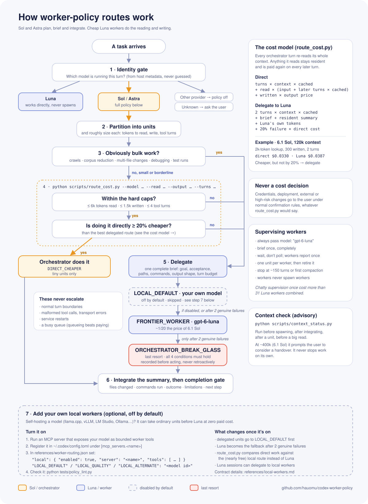

<p align="center"></p>

# codex-worker-policy

A [Codex](https://developers.openai.com/codex) skill that makes expensive models act as **orchestrators** and hand the actual work to cheap workers, so a session spends a fraction of the paid tokens it otherwise would.

`gpt-6-luna`'s token price is 1/20 of `gpt-6.1-sol` and 1/100 of `gpt-6-astra`. Per *solved* coding task the gap is smaller, but Luna at high effort still fixes a bug for about a third of what 6.1 Sol at medium costs. Every token an orchestrator reads is paid again (at the cached rate) on every later turn, so the cheapest thing a Sol or Astra session can do is plan, brief, and integrate summaries, while Luna workers do the reading and writing. This skill tells Codex how to do that without wasting the savings on chatty supervision.

## What it does

- **Identity gate.** Applies the full policy only when the running model is Sol or Astra. Luna works directly (it never spawns paid workers); other providers' models are untouched; an unknown model is asked about rather than assumed.
- **Cost-based routing.** `scripts/route_cost.py` decides whether a small unit is cheaper to do directly or to delegate, from published prices. Direct work is allowed only for tiny units (≤6k tokens read, ≤1.5k written, ≤4 turns) that are also at least 20% cheaper. Bulk work always goes to a worker.
- **Worker chosen by cost per solved task.** Most units go to Luna at `high` effort, the cheapest per solved task in OpenAI's published coding results. Terminal-heavy units (debugging, tests, builds, environment setup) go to 6.1 Sol at `low` instead: on Artificial Analysis's independent Terminal-Bench, Luna `high` solves 5% and Sol `low` 31%, which makes Sol about four times cheaper per solve. The effort is always passed explicitly: without it a worker inherits the orchestrator's effort, often `medium`, where Luna solves a quarter fewer tasks. `route_cost.py --rank` shows the whole model × effort table.
- **Supervision rules that keep the savings.** Brief once, wait instead of polling, one unit per worker, always pass `model` and `reasoning_effort`, start workers with `fork_turns: "none"`, no recursive spawning. In one measured session, chatty supervision cost more than all 31 workers combined.
- **Escalation ladder and break-glass.** A failed unit goes to a fresh Luna worker at `max`, then to 6.1 Sol at `low`; a failed terminal unit goes to 6.1 Sol at `medium`. Each step is one rung per genuine failure. The orchestrator may take over only after that, under four stated conditions, recorded before acting.
- **Cleanup pass.** High-effort workers write more code than needed. `scripts/diff_stats.py` measures each code change against its budget and flags debug leftovers; only when it says so, one cleanup worker trims the diff without changing behaviour.
- **Advisory context check.** `scripts/context_status.py` reports the session's context size and suggests a handover before auto-compaction. It never stops work by itself.
- **Optional local workers.** If you host your own model behind an MCP server, it can take ordinary units before Luna at zero marginal cost. This route ships **disabled**; see [local workers](worker-policy/references/local-workers.md).

## How it works

<p align="center"><picture><source media="(prefers-color-scheme: dark)" srcset="assets/routing-dark.svg"></picture></p>

## Install

Requires Codex with skills support and Python 3.10+.

1. Copy the `worker-policy` folder into your Codex skills directory:

   ```bash
   git clone https://github.com/hauomu/codex-worker-policy.git
   cp -r codex-worker-policy/worker-policy ~/.codex/skills/worker-policy
   ```

   On Windows: `Copy-Item -Recurse codex-worker-policy\worker-policy $env:USERPROFILE\.codex\skills\worker-policy`

2. Optionally add a line to `~/.codex/AGENTS.md` so every session applies it:

   ```text
   Use the `worker-policy` skill for cost-aware delegation. Never spawn another Sol.
   ```

3. Check the install:

   ```bash
   python ~/.codex/skills/worker-policy/tests/policy_lint.py
   ```

## Using the scripts

```bash
# Should this 2k-token lookup be done directly or delegated?
python scripts/route_cost.py --model gpt-6.1-sol --context 120000 --read 2000 --output 300 --turns 2
# ROUTE=FRONTIER_WORKER reason=DIRECT_MARGIN_NOT_MET direct=$0.0330 frontier=$0.0407 local=- caps=ok model=gpt-6.1-sol worker=gpt-6-luna@high

# Which model and effort is cheapest per solved task?
python scripts/route_cost.py --rank
# gpt-6-luna   high   score= 59.3% task=$0.084 per_solve=$0.210
# gpt-6-luna   medium score= 44.5% task=$0.052 per_solve=$0.242
# ...

# Does this worker's change need a cleanup pass?
python scripts/diff_stats.py --repo ~/code/app --base 3f2a1c9 --budget 150
# DIFF added=412 removed=37 files=6 new_files=3 budget=150 comment_ratio=0.21 debug_markers=2 status=CLEANUP_RECOMMENDED reasons=over_budget,debug_markers

# How big is this session's context?
python scripts/context_status.py
# CONTEXT model=gpt-6.1-sol context=196k window=475k prompt_at=400k status=OK
```

`--kind research|implementation|debugging|testing|review|documentation|server_crawl|bulk_reduction` fills in typical sizes when you have no estimate. `--json` prints the full calculation.

## Configuration

- **Prices:** `references/pricing.json` (machine-readable) and `references/pricing.md` (sources). Prices were checked on 2026-10-13; update both when OpenAI changes them. Cost-model tunables are documented in `pricing.md`.
- **Worker roles:** `references/worker-routing.json`. Each paid role names a model and an effort: `FRONTIER_WORKER` Luna `high`, `FRONTIER_RETRY` Luna `max`, `SOL_WORKER` 6.1 Sol `low`, `SOL_RETRY` 6.1 Sol `medium`, `CLEANUP_WORKER` Luna `high`. `ladders` and `kindLadders` decide which roles a unit climbs. The `cleanup` block sets the default diff budget. The local roles stay `null` until you enable local workers.
- **Benchmarks:** `references/model-performance.json` (machine-readable) and `references/model-performance.md` (sources and reasoning). Update them when OpenAI publishes new results; the lint refuses a worker role without a matching result.
- **Model names** reflect OpenAI's lineup as of October 2026. Unknown model ids are priced as the default orchestrator.

## Adding your own local workers (optional)

If you host your own model (llama.cpp, vLLM, LM Studio, Ollama, …), it can take ordinary units **before** Luna at zero marginal paid cost. The route is built in but switched off, because most people don't run one.

1. Run an MCP server that exposes your model as **bounded worker tools**: each call does one bounded turn (for example 240 s and 10 tool operations) and returns a status such as `COMPLETE`, `CONTINUE`, `SEMANTIC_FAILURE` or `BLOCKED`, plus an evidence summary rather than a transcript.
2. Register it in `~/.codex/config.toml` under `[mcp_servers.<name>]`.
3. Turn the gate on in `worker-policy/references/worker-routing.json`:

   ```json
   "local": { "enabled": true, "server": "<name>", "tools": ["<exact tool names>"] },
   "roles": {
     "LOCAL_DEFAULT": "<model id>",
     "LOCAL_QUALITY": "<model id>",
     "LOCAL_ALTERNATE": "<model id>",
     ...
   }
   ```

   Leave the paid roles (`FRONTIER_WORKER`, `FRONTIER_RETRY`, `SOL_WORKER`, `CLEANUP_WORKER`) as they are.

4. Run `python tests/policy_lint.py`. It refuses an enabled local route that is missing its server, tools or role models.

Once it is on:

- delegated units go to `LOCAL_DEFAULT` first, and Luna becomes the fallback after two genuine failures;
- `route_cost.py` compares direct work against the (nearly free) local route instead of Luna, so direct work is chosen even more rarely;
- Luna sessions may delegate to local workers too (they still never spawn paid workers);
- a stopped model server that starts on demand, a busy queue, or a transport error is not a failure and never escalates.

Set `"enabled": false` to switch back; nothing else needs to change. The full worker contract, including attempt accounting for controller authors, is in [local-workers.md](worker-policy/references/local-workers.md).

## License: free to use, not for resale

> **This is not plain Apache-2.0.** It is the [Apache License 2.0](LICENSE) **with the [Commons Clause](https://commonsclause.com/) condition**, which removes the right to sell the software.
>
> **Licensor:** Sherman ([@hauomu](https://github.com/hauomu))

| You may, for free | You may not, without written permission |
| --- | --- |
| Use it for personal, hobby, research or work purposes, including inside a company for your own or your team's work | Sell this skill or a modified version of it |
| Read, copy, modify and fork it | Build it into a paid product, platform, agent harness, IDE, plugin or hosted service where its functionality is all or a substantial part of what customers pay for |
| Share it or your modified version for free, keeping [LICENSE](LICENSE) and [NOTICE](NOTICE) and crediting the licensor | Charge for hosting, consulting or support whose value comes substantially from it |

Because of the Commons Clause this is **source-available**, not OSI-approved open source. The table is a summary; [LICENSE](LICENSE) is binding. For commercial licensing, contact [@hauomu](https://github.com/hauomu).

Not affiliated with or endorsed by OpenAI.
